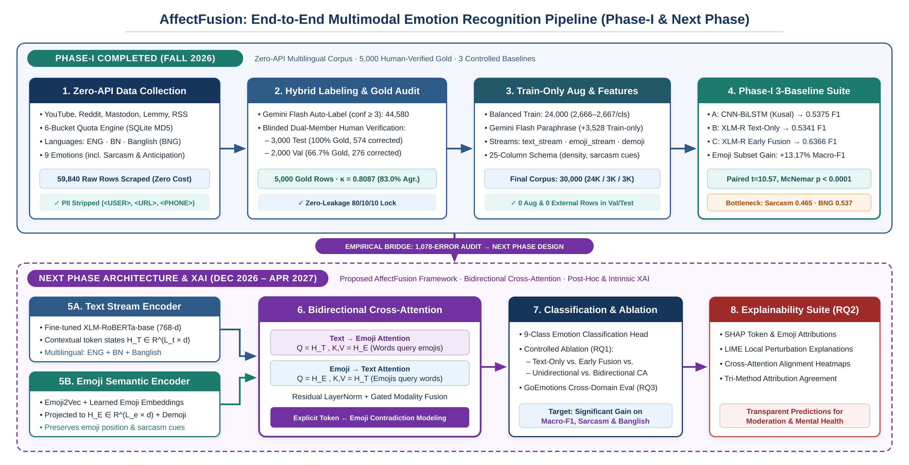

# AffectFusion: A Cross-Attention Transformer Framework for Explainable Multimodal Emotion Recognition from Text and Emoji Semantics

[](https://www.python.org/)
[](https://pytorch.org/)
[](https://huggingface.co/xlm-roberta-base)
[](https://doi.org/10.57967/hf/11874)
[](https://zenodo.org/records/24543680?preview_file=affectfusion_dataset_v1.0.0.zip)
[](https://ragibcs.github.io/affectfusion.site/)
[](LICENSE)
[](https://daffodilvarsity.edu.bd/)

Final Year Design Project (FYDP) — **Department of Computer Science and Engineering (CSE)**  
**Daffodil International University (DIU), Dhaka, Bangladesh**

- **Project Showcase Website:** [https://ragibcs.github.io/affectfusion.site/](https://ragibcs.github.io/affectfusion.site/)
- **Open Dataset (Hugging Face Hub):** [ragibhasan/AffectFusion](https://huggingface.co/datasets/ragibhasan/AffectFusion) · DOI: [`10.57967/hf/11874`](https://doi.org/10.57967/hf/11874)
- **Permanent Archive (Zenodo):** [Record #24543680](https://zenodo.org/records/24543680?preview_file=affectfusion_dataset_v1.0.0.zip) · DOI: `10.5281/zenodo.24543680`

---

## Authors & Supervision

| Role | Name | Identifier / Designation |
| :--- | :--- | :--- |
| **Researcher 1** | **MD. RAGIB HASAN** | Student ID: `232-15-775` · `hasan2305101775@diu.edu.bd` |
| **Researcher 2** | **MD. ASADULLA HEL GALIB** | Student ID: `232-15-270` · `galib2305101270@diu.edu.bd` |
| **Supervisor** | **Sharmin Akter** | Assistant Professor, Dept. of CSE, DIU |
| **Co-Supervisor** | **Dewan Mamun Raza** | Assistant Professor, Dept. of CSE, DIU |

---

## Project Overview & 11-Step Pipeline Architecture (v4)

Digital communication relies heavily on emojis to intensify, soften, or invert textual meaning—especially in sarcasm and irony (e.g., *"Perfectly executed, unlike the show itself! 👌"* or *"জনগণকে ২৪ ঘন্টা বিদ্যুৎ দিতে পারে না, আবার আসছে বৈদ্যুতিক রেল 😂"*). Text-only models discard emoji cues, while flat early-concatenation models suffer from emoji-hijacking when positive glyphs contradict negative or ironic wording.

**AffectFusion** addresses this across **English (`ENG`)**, **Native Bengali (`BN`)**, and **Romanized Banglish (`BNG`)** social media posts spanning **9 emotions** (`Joy`, `Neutral`, `Anger`, `Sadness`, `Surprise`, `Sarcasm`, `Fear`, `Disgust`, `Anticipation`).



---

## Phase-I Milestones Completed (Fall 2026 · v4 Consensus Gold)

1. **Multi-Platform Multilingual Scraping (`60,000` Raw Rows):** Harvested `60,000` raw multilingual comments (`ENG 24,000`, `BN 18,000`, `BNG 18,000`; `70%` emoji / `30%` non-emoji across ~96% YouTube via `yt-dlp`, `youtube-comment-downloader`, & YouTube Data API v3, plus Reddit/Arctic Shift, Mastodon, Lemmy, and news RSS) with disk-backed SQLite MD5 deduplication.
2. **5K-Chunk Preprocessing & PII Sanitization (`55,399` Retained):** Filtered `4,601` (`7.67%`) noisy/out-of-scope items (non-target script `3,360`, Hindi/Hinglish `860`, length `<12 chars / <3 words` or `>600 chars` `352`, duplicates `24`, spam/bots `5`), applied irreversible PII masking (`<USER>`, `<URL>`, `<EMAIL>`, `<PHONE>`), and normalized Fitzpatrick skin tones & variation selectors.
3. **Priority Queue & LLM Pseudo-Labeling (`44,580` Labeled Pool):** Prioritized minority emotions (`44,486` queued; Joy/Neutral capped at `6,500`), labeled `43,111` rows via `Gemini 3.1/3.5 Flash-Lite` (batch 25, `100%` parse rate on 100-row pilot), dropped `131` low-confidence (`conf < 3`) rows (`42,980` kept), and added `1,600` train-only `dair-ai/emotion` rows (`Fear 1,100` + `Surprise 500`).
4. **2-Round Blind-Swap Human-vs-Human Consensus Gold (`N = 5,000` Paired Rows = `10,000` Judgments):**
   - Both researchers independently annotated all `5,000` real scraped evaluation rows (`3,000` Test + `2,000` Val) across Round 1 and Round 2 blind swap without viewing each other's labels.
   - **Inter-Annotator Agreement:** **Overall `79.80%` unanimous (`3,990 / 5,000`), Cohen's κ = `0.7717`, Krippendorff's α = `0.7717`** (Substantial):
     - `ENG (n = 1,933)`: `79.20%`, `κ = 0.7651`, `α = 0.7651`
     - `BN (n = 1,653)`: `82.94%`, `κ = 0.8052`, `α = 0.8052`
     - `BNG (n = 1,414)`: `76.94%`, `κ = 0.7377`, `α = 0.7378`
     - `test_3k (n = 3,000)`: `78.03%`, `κ = 0.7515` | `val_3k (n = 2,000)`: `82.45%`, `κ = 0.8019`
   - **Joint Adjudication (`1,010` Disagreements):** `526` resolved to Annotator 1, `482` to Annotator 2, `2` to a third class (`472` Test labels and `264` Val labels updated over Round 1; tagged `is_double_adjudicated`).
5. **Zero-Leakage Balanced 80/10/10 Benchmark (`N = 30,000`):** Locked 100% real scraped `val_3k` and `test_3k` prior to any augmentation, balanced `train_24k` (`2,666–2,667` rows/class) via Train-only Gemini Flash emoji-preserving paraphrasing (`+3,528` rows across 143 calls), and engineered the dual-stream feature schema (`text_stream`, `emoji_stream`, `demoji_text`, `baseline_input`).
6. **Controlled 3-Baseline Evaluation & Statistical Significance:** Evaluated `CNN-BiLSTM (Kusal et al., 2025)`, `XLM-R Text-Only`, and `XLM-R Early Fusion` on the 100% Consensus Gold `test_3k` split under identical seed (`42`), validated via paired *t*-tests, McNemar's χ², 95% bootstrap CIs, and a `1,107`-error diagnostic audit (`192` emoji-hijacking regressions).

---

## Phase-I Benchmark Summary (`100%` Consensus Gold `test_3k`, `N = 3,000`)

### 1. Dataset Splits & Zero-Leakage Provenance

| Split | Rows (%) | Real Scraped | DAIR-AI (Train-Only) | Train-Only Aug. | Double-Verified Consensus Gold | ENG / BN / BNG (%) | Emoji % |
| :--- | :---: | :---: | :---: | :---: | :---: | :---: | :---: |
| **`train_24k`** | 24,000 (80%) | 18,872 | 1,600* | 3,528* | 0 (AI `conf ≥ 3`) | 36.4 / 36.0 / 27.6 | 59.09% |
| **`val_3k`** | 3,000 (10%) | 3,000 (100%) | 0 | 0 | 2,000 (66.7%) | 39.1 / 30.9 / 30.0 | 69.97% |
| **`test_3k`** | 3,000 (10%) | 3,000 (100%) | 0 | 0 | **3,000 (100%)** | 38.2 / 34.4 / 27.3 | 65.80% |
| **Total** | **30,000 (100%)** | **24,872** | **1,600** | **3,528** | **5,000 (κ = 0.7717, α = 0.7717)** | **36.9 / 35.3 / 27.8** | **60.85%** |

*\*`1,600` DAIR-AI rows (`Fear 1,100` + `Surprise 500`) and `3,528` Gemini Flash paraphrases (`Fear +1,384` incl. `1,116` cross-lingual ENG→BN/BNG, `Surprise +1,041`, `Anger +613`, `Disgust +396`, `Anticipation +94`) are strictly quarantined inside `train_24k`; strictly `0` augmented or external rows appear in `val_3k` or `test_3k`.*

### 2. Three-Baseline Model Performance (Consensus Gold `val_3k` & `test_3k`)

| Baseline Model | Val Acc | Val Macro-F1 | Test Acc (Micro-F1) | Test Macro-F1 | Weighted-F1 | ENG F1 | BN F1 | BNG F1 | Emoji F1 | Non-Emoji F1 | Sarcasm F1 |
| :--- | :---: | :---: | :---: | :---: | :---: | :---: | :---: | :---: | :---: | :---: | :---: |
| **CNN-BiLSTM (Kusal et al., 2025)** | 58.20% | 0.5762 | 53.37% | 0.5304 | 0.5296 | 0.4508 | 0.5648 | 0.5190 | 0.5430 | 0.4358 | 0.4517 |
| **XLM-R Text-Only** | 55.57% | 0.5420 | 54.47% | 0.5315 | 0.5364 | 0.5270 | 0.5498 | 0.4379 | 0.5101 | **0.5661** | 0.3153 |
| **XLM-R Early Fusion** | **66.27%** | **0.6534** | **63.10%** | **0.6278** | **0.6266** | **0.6220** | **0.6379** | **0.5510** | **0.6343** | 0.5604 | **0.4626** |

### 3. Paired Statistical Significance Tests (`test_3k`, `N = 3,000`)

| Model Comparison (B vs. A) | N | ΔAccuracy | Paired *t*-stat | McNemar χ² (B✓A✗ / A✓B✗) | *p*-value | ΔMacro-F1 [95% CI] |
| :--- | :---: | :---: | :---: | :---: | :---: | :---: |
| **XLM-R Early Fusion vs. Text-Only (All)** | 3,000 | **+8.63%** | +9.55 | 87.93 (508 / 249) | **< 0.0001** | **+0.0963** [0.0785, 0.1135] |
| **XLM-R Early Fusion vs. Text-Only (Emoji)** | 1,974 | **+12.56%** | +10.11 | 96.53 (440 / 192) | **< 0.0001** | **+0.1242** [0.1003, 0.1486] |
| **XLM-R Early Fusion vs. CNN-BiLSTM** | 3,000 | **+9.73%** | +11.84 | 133.15 (464 / 172) | **< 0.0001** | **+0.0974** [0.0810, 0.1135] |
| XLM-R Text-Only vs. CNN-BiLSTM (All) | 3,000 | +1.10% | +0.97 | 0.89 (595 / 562) | 0.3320 (NS) | +0.0011 [−0.0209, 0.0240] |


> **Key Diagnostic Motivation for Next Phase:** Despite statistically significant gains (`+12.42` Macro-F1 on emoji posts, `p < 0.0001`), Early Fusion still commits **`1,107` total errors**, misclassifies **`56.13%` of Sarcasm** (`0.4626` F1, `43.87%` recall), and suffers **`192` emoji-hijacking regressions** where Text-Only was right (e.g., `AFG_042100`: *"Perfectly executed, unlike the show itself! 👌"* predicted as Joy at `96.9%` confidence). This directly motivates **Bidirectional Multi-Head Cross-Attention (`Text ↔ Emoji`)**, gated modality fusion, and unified **SHAP + LIME + Cross-Attention Explainability** in the Next Phase.

---

## Repository Structure

```text
AffectFusion/
├── README.md                                  # Project overview, Phase-I v4 results & reproduction guide
├── LICENSE                                    # MIT License
├── requirements.txt                           # Python & PyTorch dependencies
├── .env.example                               # Environment variable template (no real keys)
│
├── docs/
│   ├── phase_1/
│   │   ├── AffectFusion_Phase-I_Progress_Report.docx       # Official DIU FYDP Phase-I Evaluation Report (v4)
│   │   ├── AffectFusion_Phase-I_Evaluation.pptx            # Official DIU FYDP Phase-I Presentation Slides (v4)
│   │   ├── AffectFusion_Updated_Methodology_Diagram_v4.png # High-res 11-step Architecture & Pipeline Diagram
│   │   └── AffectFusion_Updated_Methodology_v4_Editable.docx
│   ├── guidelines/
│   │   └── AffectFusion_Human_Annotation_Guidelines.md     # Dual-annotator multimodal labeling protocol
│   └── title_defense/                                      # Initial FYDP proposal archive
│
├── notebooks/
│   └── phase_1/
│       ├── 01_zero_api_scraping_cleaning_qwen_pilot.ipynb
│       ├── 02_zero_leakage_split_gold5k_augmentation_features.ipynb
│       ├── 03_eda_and_three_baseline_evaluation.ipynb
│       └── 04_round2_blind_swap_gold_verification.ipynb
│
├── src/
│   ├── scraping/                              # Multi-platform YouTube & Reddit scraping modules
│   └── annotation_qa/                         # Exploratory 100K QA & IAA calculation scripts
│
├── data/
│   ├── phase_1_final/                         # Locked 30K zero-leakage Consensus Gold splits (train_24k, val_3k, test_3k)
│   ├── gold_verification/
│   │   ├── round2_blind_swap/                 # 5,000 paired Human-vs-Human blind-swap consensus CSVs (κ = 0.7717)
│   │   └── ...                                # Round-1 audit traceability CSVs
│   └── exploratory_unlabeled/                 # Initial 100,652 unlabeled YouTube + Reddit pools
│
└── results/
    ├── figures/                               # 12 publication-grade 300-DPI EDA, Blind-Swap IAA & evaluation figures
    ├── phase_1_logs/                          # Consensus IAA reports, eval JSONs, significance tests & 1,107-error CSV
    └── exploratory_qa/                        # 100K pilot QA validation & distribution summaries
```

*(Note: Multi-gigabyte `.safetensors` checkpoints and raw `.sqlite` / `.jsonl` scraping shards are excluded via `.gitignore` to keep the repository lightweight; full reproduction is supported via the notebooks in `notebooks/phase_1/` on Google Colab Free T4 GPU.)*

---

## Quick Start & Reproduction

```bash
# 1. Clone repository
git clone https://github.com/ragibcs/AffectFusion.git
cd AffectFusion

# 2. Setup virtual environment and install dependencies
python3 -m venv venv
source venv/bin/activate          # Windows: venv\Scripts\activate
pip install -r requirements.txt

# 3. Configure environment variables (optional for Gemini paraphrasing / HF downloads)
cp .env.example .env
```

To reproduce all Phase-I EDA charts and the 3-baseline evaluation suite on Google Colab (Free T4 GPU, peak VRAM `5.24 GB`), open [`notebooks/phase_1/03_eda_and_three_baseline_evaluation.ipynb`](notebooks/phase_1/03_eda_and_three_baseline_evaluation.ipynb) with the locked Consensus Gold splits in `data/phase_1_final/`.

---

## Next Phase Roadmap (Dec 2026 – Feb 2027)

- [ ] **Dual Encoders:** Fine-tuned `XLM-RoBERTa-base` text stream + `Emoji2Vec` / learned positional emoji semantic encoder (`d = 768`).
- [ ] **Bidirectional Cross-Attention & Gated Fusion:** Explicit `Text → Emoji` and `Emoji → Text` multi-head cross-attention to suppress emoji-hijacking and capture ironic contradiction.
- [ ] **Controlled Ablation & GoEmotions Generalization:** Quantify fusion increments on Consensus Gold `test_3k` and benchmark cross-domain transfer vs. GoEmotions.
- [ ] **Integrated Explainability Suite:** Unified `SHAP`, `LIME`, and Cross-Attention heatmaps with quantitative tri-method attribution agreement.
- [ ] **Demo Prototype & Final Thesis Submission:** Interactive real-time demo, sarcasm/contradiction case study, and peer-reviewed research manuscript submission.

---

*© 2026 Department of Computer Science and Engineering, Daffodil International University.*
