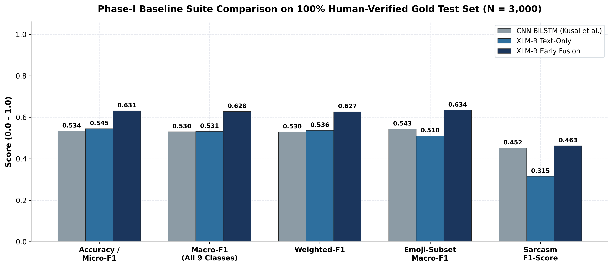

# AffectFusion: A Cross-Attention Transformer Framework for Explainable Multimodal Emotion Recognition from Text and Emoji Semantics

[](https://www.python.org/)
[](https://pytorch.org/)
[](https://huggingface.co/xlm-roberta-base)
[](LICENSE)
[](https://daffodilvarsity.edu.bd/)
[](docs/phase_1/)

Final Year Design Project (FYDP) — **Department of Computer Science and Engineering (CSE)**  
**Daffodil International University (DIU), Dhaka, Bangladesh**

---

## Authors & Supervision

| Role | Name | Identifier / Designation |
| :--- | :--- | :--- |
| **Researcher 1** | **MD. RAGIB HASAN** | Student ID: `232-15-775` · `hasan2305101775@diu.edu.bd` |
| **Researcher 2** | **MD. ASADULLA HEL GALIB** | Student ID: `232-15-270` · `galib2305101270@diu.edu.bd` |
| **Supervisor** | **Sharmin Akter** | Assistant Professor, Dept. of CSE, DIU |
| **Co-Supervisor** | **Dewan Mamun Raza** | Assistant Professor, Dept. of CSE, DIU |

---

## Project Overview & Pipeline Architecture

Digital communication relies heavily on emojis to intensify, soften, or invert textual meaning—especially in sarcasm and irony (e.g., *"Great, just what I needed 🙄"* or *"বাহ বাহ বেশ ভালই বিচার ... 👏"*). Text-only models discard emoji cues, while static early-concatenation models fail to learn fine-grained token-emoji alignment.

**AffectFusion** addresses this across **English (`ENG`)**, **Native Bengali (`BN`)**, and **Romanized Banglish (`BNG`)** social media posts spanning **9 emotions** (`Joy`, `Neutral`, `Anger`, `Sadness`, `Surprise`, `Sarcasm`, `Fear`, `Disgust`, `Anticipation`).


---

## Phase-I Milestones Completed (Fall 2026)

1. **Zero-API Multilingual Scraping & Privacy Pipeline:** Harvested **59,840** raw multilingual social media comments (YouTube, Reddit/Arctic Shift, Mastodon, Lemmy, RSS) using disk-backed SQLite MD5 deduplication and automated PII redaction (`<USER>`, `<URL>`, `<EMAIL>`, `<PHONE>`).
2. **Hybrid Auto-Labeling & 5,000-Row Blinded Human Gold Verification:** Auto-labeled **44,580** high-confidence rows (`conf >= 3`) using `Gemini Flash-Lite` (following a 4-bit NF4 `Qwen2.5-7B-Instruct` pilot), then manually verified **5,000 real scraped rows** blindly across both researchers (`2,500` each):
   - **Combined Gold Agreement (`N = 5,000`):** **83.00% Raw Agreement**, **Cohen's κ = 0.8087** (`ENG`: `0.8129`, `BN`: `0.8128`, `BNG`: `0.7958`).
   - Upgraded **`test_3k`** to **100% Human-Verified Gold** (`574` labels corrected) and **`val_3k`** to **66.7% Human-Verified Gold** (`276` labels corrected).
3. **Zero-Leakage 80/10/10 Benchmark (`N = 30,000`):** Locked 100% real scraped validation (`3,000`) and test (`3,000`) splits, balanced `train_24k` (`2,666–2,667` rows/class) via Train-only Gemini Flash emoji-preserving paraphrasing (`+3,528` rows), and engineered a 25-column dual-stream feature schema (`text_stream`, `emoji_stream`, `demoji_text`, `baseline_input`).
4. **Controlled 3-Baseline Suite & Statistical Significance:** Replicated Kusal et al. (2025) `CNN-BiLSTM` adapted for multilingual subwords alongside `xlm-roberta-base` Text-Only and `xlm-roberta-base` Early Fusion under identical splits and seed (`42`), backed by paired *t*-tests, McNemar's χ², 95% bootstrap CIs, and a `1,078`-error diagnostic audit.

---

## Phase-I Benchmark Summary (`100%` Human-Verified Gold `test_3k`, `N = 3,000`)

### 1. Dataset Splits & Zero-Leakage Provenance

| Split | Rows (%) | Real Scraped | DAIR-AI (Train-Only) | Train-Only Aug. | Human Gold Verified | ENG / BN / BNG (%) | Emoji % |
| :--- | :---: | :---: | :---: | :---: | :---: | :---: | :---: |
| **`train_24k`** | 24,000 (80%) | 18,872 | 1,600* | 3,528* | 0 (AI `conf≥3`) | 36.4 / 36.0 / 27.6 | 59.09% |
| **`val_3k`** | 3,000 (10%) | 3,000 (100%) | 0 | 0 | 2,000 (66.7%) | 39.1 / 30.9 / 30.0 | 69.97% |
| **`test_3k`** | 3,000 (10%) | 3,000 (100%) | 0 | 0 | **3,000 (100%)** | 38.2 / 34.4 / 27.3 | 65.80% |
| **Total** | **30,000 (100%)** | **24,872** | **1,600** | **3,528** | **5,000 (κ = 0.8087)** | **36.9 / 35.3 / 27.8** | **60.85%** |

*\*1,147 of the 3,528 Fear paraphrases were derived from DAIR-AI Twitter seeds (`2,747` Train rows tagged `is_external_train_only=1`); strictly `0` augmented or external rows appear in `val_3k` or `test_3k`.*

### 2. Three-Baseline Model Performance

| Baseline Model | Val Acc | Val Macro-F1 | Test Acc (Micro-F1) | Test Macro-F1 | Weighted-F1 | ENG F1 | BN F1 | BNG F1 | Emoji F1 | Non-Emoji F1 | Sarcasm F1 |
| :--- | :---: | :---: | :---: | :---: | :---: | :---: | :---: | :---: | :---: | :---: | :---: |
| **CNN-BiLSTM (Kusal et al., 2025)** | 59.50% | 0.5892 | 54.20% | 0.5375 | 0.5384 | 0.4534 | 0.5827 | 0.5082 | 0.5537 | 0.4313 | 0.4495 |
| **XLM-R Text-Only** | 55.97% | 0.5462 | 54.50% | 0.5341 | 0.5354 | 0.5501 | 0.5306 | 0.4335 | 0.5096 | 0.5777 | 0.3024 |
| **XLM-R Early Fusion** | **68.00%** | **0.6698** | **64.07%** | **0.6366** | **0.6361** | **0.6430** | **0.6512** | **0.5367** | **0.6413** | 0.5702 | **0.4654** |

### 3. Paired Statistical Significance Tests (`test_3k`)

| Model Comparison (B vs. A) | N | ΔAccuracy | Paired *t*-stat | McNemar χ² (B✓A✗ / A✓B✗) | *p*-value | ΔMacro-F1 [95% CI] |
| :--- | :---: | :---: | :---: | :---: | :---: | :---: |
| **XLM-R Early Fusion vs. Text-Only (All)** | 3,000 | **+9.57%** | +10.57 | 106.92 (526 / 239) | **< 0.0001** | **+0.1025** [0.0846, 0.1198] |
| **XLM-R Early Fusion vs. Text-Only (Emoji)** | 1,974 | **+13.93%** | +11.24 | 117.86 (456 / 181) | **< 0.0001** | **+0.1317** [0.1072, 0.1582] |
| **XLM-R Early Fusion vs. CNN-BiLSTM** | 3,000 | **+9.87%** | +12.07 | 138.13 (463 / 167) | **< 0.0001** | **+0.0991** [0.0839, 0.1156] |
| XLM-R Text-Only vs. CNN-BiLSTM (All) | 3,000 | +0.30% | +0.26 | 0.05 (590 / 581) | 0.7926 (NS) | −0.0033 [−0.0277, 0.0202] |



> **Key Diagnostic Motivation for Next Phase:** Despite statistically significant overall gains, Early Fusion still misclassifies **57.25% of Sarcasm** (`0.4654` F1, `42.75%` recall) and exhibits **emoji-hijacking** on Banglish (`0.5367` F1), directly motivating **Bidirectional Multi-Head Cross-Attention (`Text ↔ Emoji`)**, gated modality fusion, and unified **SHAP + LIME + Cross-Attention Explainability** in the next phase.

---

## Repository Structure

```text
AffectFusion/
├── README.md                                  # Project overview, Phase-I results & reproduction guide
├── LICENSE                                    # MIT License
├── requirements.txt                           # Python & PyTorch dependencies
├── .env.example                               # Environment variable template (no real keys)
│
├── docs/
│   ├── phase_1/
│   │   ├── AffectFusion_Phase-I_Progress_Report.docx   # Official DIU FYDP Phase-I Evaluation Report
│   │   └── AffectFusion_Phase-I_Evaluation.pptx        # Official DIU FYDP Phase-I Presentation Slides
│   ├── guidelines/
│   │   └── AffectFusion_Human_Annotation_Guidelines.md # Dual-annotator multimodal labeling protocol
│   └── title_defense/                                  # Initial FYDP Title Defense documents
│
├── notebooks/
│   └── phase_1/
│       ├── 01_zero_api_scraping_cleaning_qwen_pilot.ipynb
│       ├── 02_zero_leakage_split_gold5k_augmentation_features.ipynb
│       └── 03_eda_and_three_baseline_evaluation.ipynb
│
├── src/
│   ├── scraping/                              # Multi-platform YouTube & Reddit scraping modules
│   └── annotation_qa/                         # Exploratory 100K QA & IAA calculation scripts
│
├── data/
│   ├── phase_1_final/                         # Locked 30K zero-leakage splits (train_24k, val_3k, test_3k)
│   ├── gold_verification/                     # 5,000 blinded human-verified gold annotations (κ = 0.8087)
│   └── exploratory_unlabeled/                 # Initial 100,652 unlabeled YouTube + Reddit pools
│
└── results/
    ├── figures/                               # 11 publication-grade 300-DPI EDA & evaluation figures
    ├── phase_1_logs/                          # Training histories, eval metrics, significance tests & configs
    └── exploratory_qa/                        # 100K pilot QA validation & distribution summaries
```

*(Note: Multi-gigabyte `.safetensors` checkpoints and raw `.sqlite` / `.jsonl` scraping shards are excluded via `.gitignore` to keep the repository lightweight; full reproduction is supported via the notebooks in `notebooks/phase_1/` on Google Colab Free T4 GPU.)*

---

## Quick Start & Reproduction

```bash
# 1. Clone repository
git clone https://github.com/ragibcs/AffectFusion.git
cd AffectFusion

# 2. Setup virtual environment and install dependencies
python3 -m venv venv
source venv/bin/activate          # Windows: venv\Scripts\activate
pip install -r requirements.txt

# 3. Configure environment variables (optional for Gemini paraphrasing / HF downloads)
cp .env.example .env
```

To reproduce all Phase-I EDA charts and the 3-baseline evaluation suite on Google Colab (Free T4 GPU, peak VRAM `5.24 GB`), open [`notebooks/phase_1/03_eda_and_three_baseline_evaluation.ipynb`](notebooks/phase_1/03_eda_and_three_baseline_evaluation.ipynb) with the locked splits in `data/phase_1_final/`.

---

## Next Phase Roadmap (Dec 2026 – Apr 2027)

- [ ] **Dual Encoders:** Fine-tuned `XLM-RoBERTa-base` text stream + `Emoji2Vec` / learned positional emoji semantic encoder.
- [ ] **Bidirectional Cross-Attention & Gated Fusion:** Explicit `Text → Emoji` and `Emoji → Text` multi-head cross-attention to resolve sarcasm & emoji-hijacking.
- [ ] **Controlled Ablation & GoEmotions Generalization:** Quantify fusion increments on Gold `test_3k` and benchmark cross-domain transfer vs. GoEmotions.
- [ ] **Integrated Explainability Suite:** Unified `SHAP`, `LIME`, and Cross-Attention heatmaps with quantitative tri-method attribution agreement.
- [ ] **Demo Prototype & Final Thesis:** Interactive demo, sarcasm/contradiction case study, and final FYDP thesis submission.

---

*© 2026 Department of Computer Science and Engineering, Daffodil International University.*
